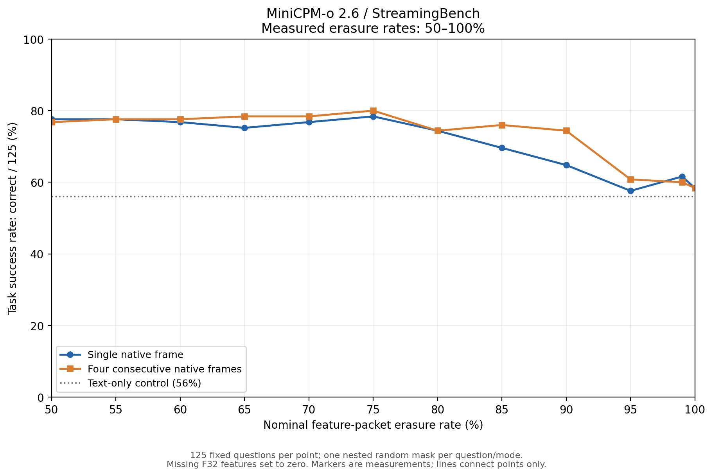

# MiniCPM-o 2.6 / StreamingBench 实测

<!-- testbed-rtc-20261010 -->
2026-10-10 原版 Testbed RTC 接入：已完成 **单帧 98/125（78.4%）、四帧 101/125（80.8%）** 无扰动基线。
250 题接收特征字节核验通过；答案、生成 token 及首步完整 logits 与同运行时未拆分 helper 一致。
四种网络配置另有每条件 5 题的预检；完整受扰动批次尚未完成。当前仅按提问点加速传输特征，不代表持续 FPS 流量。

[RTC 完整报告](results/testbed_rtc_baseline_20261010/report_zh.md) · [网络预检](results/testbed_rtc_readiness_20261010/report_zh.md) · [原版源码补丁与复现](docs/testbed_rtc.md)

以下为先前 Windows Vulkan / 离线特征擦除结果，与上述 Linux RTC 结果分开比较。

2026-10-10 补测：新增 55%、60%、65%、70%、75%、80%、85%、90%、95%、99% 十个特征丢包率，单帧与连续四帧各 125 题，共新增 **2500 次真实推理**。连同既有结果，共 **23 个丢包率、46 个完整条件、5750 次回答**。

**两种输入最大的相邻点绝对下降都出现在 90%→95% 丢包：单帧 64.8%→57.6%（下降 7.2 个百分点），四帧 74.4%→60.8%（下降 13.6 个百分点）。** 单帧从 80% 到 95% 已有连续下降；曲线不严格单调。



[最新完整报告与 0%–100% 图](results/feature_packet_loss_highrange_curve/report_zh.md) · [各点汇总](results/feature_packet_loss_highrange_curve/condition_summary.csv) · [相邻点变化](results/feature_packet_loss_highrange_curve/adjacent_changes.csv) · [复现说明](docs/feature_packet_loss.md)

| 设定丢包率 | 单帧准确率 | 连续四帧准确率 |
|---:|---:|---:|
| 0% | 78.4% | 80.0% |
| 50% | 77.6% | 76.8% |
| 55% | 77.6% | 77.6% |
| 60% | 76.8% | 77.6% |
| 65% | 75.2% | 78.4% |
| 70% | 76.8% | 78.4% |
| 75% | 78.4% | 80.0% |
| 80% | 74.4% | 74.4% |
| 85% | 69.6% | 76.0% |
| 90% | 64.8% | 74.4% |
| 95% | 57.6% | 60.8% |
| 99% | 61.6% | 60.0% |
| 100% | 58.4% | 58.4% |

同一批 25 个视频、125 道问题，同一模型、运行时、提示词与固定随机种子。新增运行的逐题原始特征 SHA-256 和帧元数据与既有运行完全一致。全部 5750 条回答已独立重评分、重建缺包掩码并核验服务器特征哈希。6 个无效响应按错误计分，每条件分母固定为 125。

IP MTU 1500 字节预算，每包 1432 字节 F32 特征，单帧 1923 包、四帧 7689 包，缺包对应特征置零。**本轮为离线特征擦除、可靠本地 TCP 传输，不是 Testbed 的真实 RTC/network profile 实测。** 每题仅一组固定随机掩码，未进行多种子统计显著性检验。

纯文本对照为 56.0%，全部视觉特征置零为 58.4%；高丢包下的残余总分不能直接解释为视觉容错。所有实测点均保留，连线不是拟合，未强制单调或隐藏全零对照。

[初次七点报告](results/feature_packet_loss/report_zh.md) · [20%–50% 历史补测报告](results/feature_packet_loss_curve/report_zh.md) · [全零与纯文本对照](results/zero_feature_controls/report_zh.md)

---
评测日期：2026-10-09。已完成两种输入方式各 125 道题，共 250 次实际模型回答。

| 输入方式 | 答对/总题数 | 准确率 | 平均单题请求耗时 |
|---|---:|---:|---:|
| 提问时刻对应的单帧 | 98/125 | **78.40%** | 0.530 秒 |
| 该帧及之前连续三帧 | 100/125 | **80.00%** | 1.672 秒 |

四帧净多答对 2 题，准确率增加 1.60 个百分点，请求耗时约为单帧的 3.16 倍。
4 题由错变对，2 题由对变错。此固定子集的差异不能说明所有视频任务都能稳定获益。

[完整中文报告](results/native_comparison/report_zh.md) ·
[125 题逐题对照](results/native_comparison/paired_predictions.csv) ·
[汇总 JSON](results/native_comparison/comparison.json) ·
[500 帧顺序解码核验](results/q4_k_m_four_native/frame_audit.json)

新增[全零特征与纯文本对照](results/zero_feature_controls/report_zh.md)：全零单帧在新进程中精确复现 58.4%，完全无视觉输入的纯文本也达到 56.0%。这些语言基线必须与丢包准确率一同解读。

评测目标：用户指定 ZIP 中数值编号 1–25 的视频，每个视频 5 道题，共 125 道。

当前按用户更新的要求比较 **提问时刻对应的单帧** 与 **该帧和紧邻的前三帧**。
源帧严格连续，不做时间抽样或 FPS 变换；若提问时间位于两帧之间，取此前最近帧。
采用作者发布的 GGUF **Q4_K_M** 语言模型、**F16** 视觉编码器，
llama.cpp b11516，RTX 3070 8 GB。使用官方选择题提示词，贪心解码，答案不进入推理请求。
这是量化版、仅视觉、独立问答评测。预处理、运行时和输入方式与
官方 BF16 / omni streaming 适配器不同，不能将结果称为其完整复现。

```powershell
# Windows / Python 3.12；下载的模型、视频和运行时不在本仓库内
python -m pip install -r requirements.txt
# 分块下载作者镜像权重和 Vulkan 运行时；验证官方 SHA-256
python -u range_download.py
# 从用户指定原始 ZIP 按成员分块下载视频 1–25，并验证 ZIP CRC
python -u prepare_videos_ranged.py
# 本次实际使用已核验的 Vulkan 运行时，启动参数见 start_server.ps1
.\start_server.ps1
# 按原始显示帧序号解码，准备 125 组连续四帧
python -u native_frames.py
# 可断点续跑，两组使用相同末帧，每题立即保存原始响应
python -u evaluate.py --mode single --output results/q4_k_m_single_native
python -u evaluate.py --mode native4 --output results/q4_k_m_four_native
# 独立读取原始响应和原始标注重新评分
python score_results.py results/q4_k_m_single_native
python score_results.py results/q4_k_m_four_native
python verify_frames.py results/q4_k_m_four_native
python compare_native.py
python -m unittest test_evaluation -v
```

如只需复核已发布答案的评分，无需下载模型或视频。先获取固定版本的原始标注，再评分：

```powershell
New-Item -ItemType Directory -Force data | Out-Null
Invoke-WebRequest -Uri 'https://huggingface.co/datasets/mjuicem/StreamingBench/resolve/48872fa707124474ce4c5172ddc58efb8bc88058/StreamingBench/Real_Time_Visual_Understanding.csv' -OutFile 'data/Real_Time_Visual_Understanding.csv'
python score_results.py results/q4_k_m_single_native
python score_results.py results/q4_k_m_four_native
python compare_native.py
```

原始标注 SHA-256 为 `0121417a71e1dcf367222ae97e9512e3e99725d72e60d50760a050816ccd58da`。
上述操作重新计算分数，源视频像素审计仍需下载视频后运行 `native_frames.py` 和 `verify_frames.py`。
完整推理脚本支持断点续跑；如需全新重跑，请先将两组已发布的结果目录移到备份位置，避免跳过已完成题目。

Vulkan 运行时来自 [llama.cpp b11516 官方发行版](https://github.com/ggml-org/llama.cpp/releases/tag/b11516)，
文件 `llama-b11516-bin-win-vulkan-x64.zip`，SHA-256:
`01dff69c02650624d401be0b170348ea38f4bcdca24cb97a7415cddb7315414b`。
解压至 `runtime/vulkan`。启动服务只监听 `127.0.0.1:18086`。

比较报告和逐题配对结果保存在 `results/native_comparison/`。
两组原始结果分别保存在 `results/q4_k_m_single_native/`、`results/q4_k_m_four_native/`：

- `config.json`：固定推理配置、提示词和预处理。
- `questions_manifest.json`：125 题清单及标准答案。
- `predictions.jsonl`：逐题原始响应、预测、标签、帧时间戳及耗时。
- `predictions.csv`：独立评分后生成的便于检查的逐题表格。
- `summary.json`：独立评分生成的完成状态和总体/分任务/分视频准确率。

`results/provenance.json` 记录数据、模型和基准代码版本及官方哈希。
`results/videos_manifest.json` 保存实际下载视频的 SHA-256 和 ZIP CRC；
`results/archive_inventory.json` 保存原始 ZIP 的成员目录。下载脚本会在 `data/` 下生成新的清单。
文件接收成功、服务加载成功和单题通过均不代表 125 题评测完成。
此前 60 秒历史窗口实验因输入协议改变而停止，部分结果仅在本地保留，不在此仓库中发布或纳入比较。

发布文件校验值见 [SHA256SUMS](SHA256SUMS)。本仓库包含报告、原始模型回答、公开标注子集、配置及复现脚本；
模型权重、视频、抽取图像、运行时二进制和本地服务日志不随仓库分发。上游来源与权利说明见 [NOTICE.md](NOTICE.md)。

来源：
[StreamingBench 官方代码](https://github.com/THUNLP-MT/StreamingBench)、
[原始数据集](https://huggingface.co/datasets/mjuicem/StreamingBench)、
[作者 GGUF 权重](https://huggingface.co/openbmb/MiniCPM-o-2_6-gguf)。
