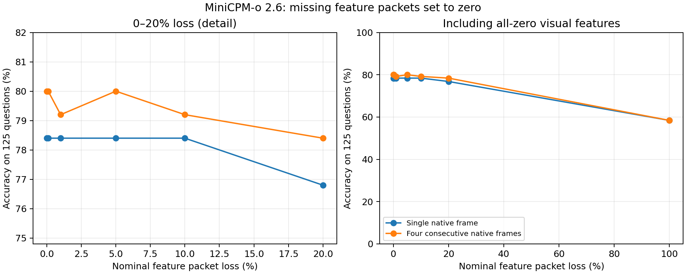

# MiniCPM-o 2.6 视觉特征分包丢包置零实验

日期：2026-10-09。对前 25 个视频的 125 个问题，分别使用提问时刻单帧及该帧与紧邻的前三个原生帧。
所有 14 个条件均完成 125 题，共 1750 次真实模型回答。

| 设定丢包率 | 单帧答对/125 | 单帧准确率 | 四帧答对/125 | 四帧准确率 |
|---:|---:|---:|---:|---:|
| 0% | 98/125 | 78.40% | 100/125 | 80.00% |
| 0.1% | 98/125 | 78.40% | 100/125 | 80.00% |
| 1% | 98/125 | 78.40% | 99/125 | 79.20% |
| 5% | 98/125 | 78.40% | 100/125 | 80.00% |
| 10% | 98/125 | 78.40% | 99/125 | 79.20% |
| 20% | 96/125 | 76.80% | 98/125 | 78.40% |
| 100% | 73/125 | 58.40% | 73/125 | 58.40% |

## 结果解释

20% 分包丢失时，单帧准确率为 76.8%，比无丢包下降 1.6 个百分点；四帧为 78.4%，下降 1.6 个百分点。
全部视觉特征置零后，单帧和四帧分别仍答对 73 和 73 题。这表明问题与选项的语言先验可能贡献相当部分准确率；不能把残余准确率都归因于视觉特征抗丢包能力。
后续新增 375 次控制推理：新进程全零单帧精确复现 58.4%，完全移除视觉输入的纯文本为 56.0%，轮换选项并映射答案后仍为 56.0%。详见[全零特征与纯文本核查报告](../zero_feature_controls/report_zh.md)。
在这 125 题和本轮固定随机掩码下，0%–20% 丢包的准确率变化较小。1% 与 5% 等点位不必单调，需结合逐题变化解释；本轮没有多种子重复，不能宣称统计显著或普遍容错。

## 实验方法

视觉编码器及 resampler/projector 在端侧生成连续 F32 特征，服务器运行 Q4_K_M 语言模型。
特征在每题每种输入方式下只编码一次，各丢包率复用完全相同的原始特征。
问题、图像切片标记、特征形状及位置不变，语言 KV 缓存每次清空；采用原有官方选择题提示词和贪心解码。

**分包预算：**1500 字节是 IP MTU，不含以太网头；扣除 IPv4 20、UDP 8、RTP 12、特征分片头 16、
SRTP 认证标签 10 字节后，向下对齐到完整 float32，得到每个完整包 1432 字节特征（358 个数值）。
模型每帧产生 3×64×3584 个数值，即 2,752,512 字节；四帧 11,010,048 字节。
按连续特征缓冲区分包，单帧 1923 包、四帧 7689 包。最后一个包允许不足 1432 字节。

**丢包与填补：**每包独立 Bernoulli 丢失，丢失包覆盖的全部特征字节设为零，保持原始张量形状和位置。
不填补上一帧、不重传、不使用 FEC。没有制造位翻转或不完整 float32，也没有直接丢弃整个图像。
问题文本和控制元数据受到保护，不参与本次丢包。100% 丢包（若列于表中）是所有视觉特征置零对照，
保留了图像标记与问题文本，不等同于删除图像 token 的纯文本提示。

**可复现随机性：**基础种子 20261009，每个问题/输入方式通过 SHA-256 派生独立种子。
不同丢包率使用相同的均匀随机数，高丢包率的缺失集合包含低丢包率集合。
这是每题一个随机掩码的探索性实验，没有重复多个随机种子；小幅准确率差异不代表稳定增益。

总准确率不变不代表模型内部输出没有变化；condition_summary.csv 另记录首步 logits 哈希发生变化的题数。

## 实际丢包与答案变化

| 输入 | 设定丢包率 | 实际丢包率 | 置零特征比例 | 正确变错误 | 错误变正确 | 答案发生变化 |
|---|---:|---:|---:|---:|---:|---:|
| 四帧 | 0% | 0.0000% | 0.0000% | 0 | 0 | 0 |
| 四帧 | 0.1% | 0.0999% | 0.0999% | 0 | 0 | 0 |
| 四帧 | 1% | 1.0020% | 1.0020% | 1 | 0 | 1 |
| 四帧 | 5% | 4.9966% | 4.9968% | 1 | 1 | 2 |
| 四帧 | 10% | 10.0218% | 10.0219% | 2 | 1 | 3 |
| 四帧 | 20% | 20.0409% | 20.0410% | 5 | 3 | 9 |
| 四帧 | 100% | 100.0000% | 100.0000% | 35 | 8 | 47 |
| 单帧 | 0% | 0.0000% | 0.0000% | 0 | 0 | 0 |
| 单帧 | 0.1% | 0.1028% | 0.1028% | 0 | 0 | 0 |
| 单帧 | 1% | 1.0034% | 1.0035% | 0 | 0 | 0 |
| 单帧 | 5% | 4.9656% | 4.9656% | 0 | 0 | 0 |
| 单帧 | 10% | 9.9465% | 9.9456% | 0 | 0 | 0 |
| 单帧 | 20% | 19.9667% | 19.9656% | 2 | 0 | 3 |
| 单帧 | 100% | 100.0000% | 100.0000% | 35 | 10 | 50 |

## 核验与结论边界

独立重评分验证了全部 1750 条回答、固定标签、随机掩码、置零字节数和服务器收到的特征哈希。
无效回答计为错误，所有完整条件准确率以 125 为分母；原始回答及逐题掩码均保留。
0% 条件与此前无丢包拆分基线逐题比较了 250 个样例的特征哈希、答案和首步完整 logits 哈希，结果见 audit.json。
输入帧沿用已核验缓存，空间预处理为 588×336 JPEG，时间轴没有抽样；不得将结果称为原始分辨率输入。

**本次是离线特征包擦除实验。**MTU 和协议开销是分片大小的建模假设，没有声称发送真实 SRTP 包。
受损特征通过可靠本地 TCP 送入语言模型，以隔离特征缺失本身对准确率的影响。
置零后的缓冲区长度保持不变，并非实际减少网络发送字节；这里的耗时不能用于评价丢包链路传输效率。
本次没有真实网卡丢包、乱序、延迟、拥塞、RTC 抖动缓冲、重传或 FEC，因此不能当作 Testbed 网络 profile 实测。
后续正式网络测试应沿用原版 Testbed/Liquid 的场景、信令、aiortc RTP、netem、抓包及日志流程。
高丢包率下残余准确率还可能来自问题/选项的语言先验，不能仅据答题准确率断言视觉信息完全保留。

## 复核

逐题结果：question_results.csv；汇总：condition_summary.csv；完整审计：audit.json。
各模式/loss_* 目录保存原始响应、标签、丢包位置、种子、特征哈希及逐条件汇总。
模型与运行时的固定 SHA-256、提示词和 MTU 预算在 config.json 中。

上游：[作者 GGUF](https://huggingface.co/openbmb/MiniCPM-o-2_6-gguf)、
[StreamingBench](https://huggingface.co/datasets/mjuicem/StreamingBench)、
[llama.cpp b11516](https://github.com/ggml-org/llama.cpp/releases/tag/b11516)。
