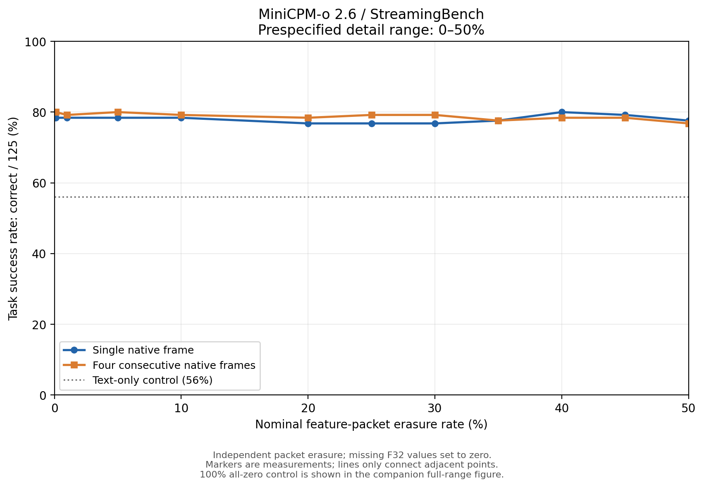
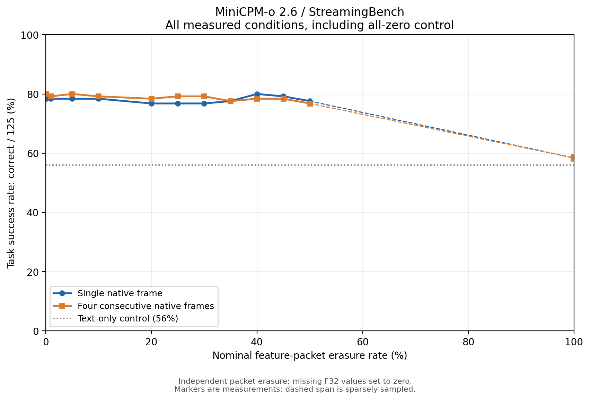

# MiniCPM-o 2.6：20%–50% 丢包补测与任务成功率曲线

日期：2026-10-10。新增 25%、30%、35%、40%、45%、50% 六个丢包率，每点单帧与连续四帧各 125 题，共新增 1500 次真实推理。
合并既有条件后共 26 个完整条件、3250 次回答。

“任务成功率”定义为固定 125 道四选一问题的答题准确率；横轴是视觉特征包丢失率，不是比特错误率或解码错误率。

## 0%–50% 主图

主图范围在新增结果产生前固定为 0%–50%，包含该区间全部实测点。没有按结果形状筛选点、强制单调或拟合“先平后陡”曲线。

## 全范围对照

100% 是已有的全部视觉特征置零对照。50%–100% 之间没有实测点，虚线只连接端点，不代表该区间形状或存在何处的平台。

## 全部实测点

| 丢包率 | 单帧答对/125 | 单帧成功率 | 四帧答对/125 | 四帧成功率 |
|---:|---:|---:|---:|---:|
| 0% | 98 | 78.4% | 100 | 80.0% |
| 0.1% | 98 | 78.4% | 100 | 80.0% |
| 1% | 98 | 78.4% | 99 | 79.2% |
| 5% | 98 | 78.4% | 100 | 80.0% |
| 10% | 98 | 78.4% | 99 | 79.2% |
| 20% | 96 | 76.8% | 98 | 78.4% |
| 25% | 96 | 76.8% | 99 | 79.2% |
| 30% | 96 | 76.8% | 99 | 79.2% |
| 35% | 97 | 77.6% | 97 | 77.6% |
| 40% | 100 | 80.0% | 98 | 78.4% |
| 45% | 99 | 79.2% | 98 | 78.4% |
| 50% | 97 | 77.6% | 96 | 76.8% |
| 100% | 73 | 58.4% | 73 | 58.4% |

## 实测变化

单帧：0%、20%、50% 丢包率的成功率分别为 78.4%、76.8%、77.6%；整个 0%–50% 区间的实测值在 76.8%–80.0% 之间。
连续四帧：0%、20%、50% 丢包率的成功率分别为 80.0%、78.4%、76.8%；整个 0%–50% 区间的实测值在 76.8%–80.0% 之间。
曲线形状以这些实测点为准；上述分数没有经过平滑、单调化或按预期形状筛选。
个别点高于无损基线只反映本轮逐题正确/错误变化，不能据此证明丢包提升能力。

## 新增点的逐题变化

| 输入 | 丢包率 | 正确变错误 | 错误变正确 | 答案改变 |
|---|---:|---:|---:|---:|
| 连续四帧 | 25% | 4 | 3 | 8 |
| 连续四帧 | 30% | 3 | 2 | 7 |
| 连续四帧 | 35% | 4 | 1 | 6 |
| 连续四帧 | 40% | 4 | 2 | 8 |
| 连续四帧 | 45% | 4 | 2 | 7 |
| 连续四帧 | 50% | 6 | 2 | 9 |
| 单帧 | 25% | 2 | 0 | 4 |
| 单帧 | 30% | 3 | 1 | 4 |
| 单帧 | 35% | 3 | 2 | 5 |
| 单帧 | 40% | 1 | 3 | 4 |
| 单帧 | 45% | 2 | 3 | 6 |
| 单帧 | 50% | 3 | 2 | 6 |

## 核验与解释边界

沿用 MTU 1500 字节建模预算，每包 1432 字节 F32 特征，缺包覆盖的完整特征位置置零。无重传、FEC 或前帧补填。
模型、运行时、量化、提示词、随机种子、视频帧及输入特征哈希均与既有实验一致。新增运行重新编码，但逐题哈希确认特征字节与原运行相同。
每题一个固定随机掩码，各率的缺包集合嵌套；全部原始响应、标签、缺包位置及哈希保存。独立重评分及随机掩码审计覆盖全部条件，无效响应计错，分母固定 125。
每题仅一个种子、仅这 25 个视频，局部波动不代表统计显著或普遍趋势；没有保证曲线单调下降，也没有预设明显下降的拐点。
纯文本对照为 56.0%，全零视觉特征为 58.4%。残余总分不能直接解释为视觉容错；仍应结合逐题正确变错误/错误变正确以及语言基线解读。
本轮仍为离线特征擦除，经可靠本地 TCP 输入语言模型；不是原版 Testbed 的实际网卡网络 profile 测试。

汇总及逐题变化见 condition_summary.csv；完整审计与各运行配置见 audit.json。PNG/PDF/SVG 均随报告发布。
