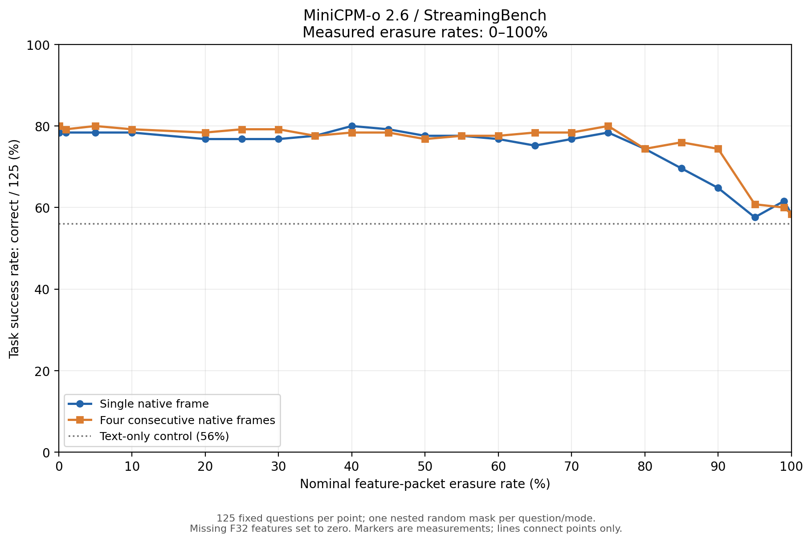

# MiniCPM-o 2.6：50%–100% 特征丢包补测

日期：2026-10-10。新增 55%、60%、65%、70%、75%、80%、85%、90%、95%、99% 十个点，单帧与连续四帧各 125 题，共新增 2500 次真实模型推理。与既有结果合并为 23 个丢包率、46 个条件、5750 次回答；另有 375 次独立对照不计入该数字。

任务成功率指固定 125 道四选一问题的准确率。横轴是视觉特征包擦除概率，不是比特错误率；所有缺包对应的 F32 特征置零。

## 50%–100% 实测曲线

所有新增点和既有 50%、100% 端点均展示；连线仅连接实测点，不是拟合。

## 下降集中在哪些相邻采样区间

单帧最大的相邻点绝对下降为 7.2 个百分点，发生于 90%→95%：64.8%→57.6%。
单帧从 50% 到 100% 丢包，准确率从 77.6% 变为 58.4%，净下降 19.2 个百分点。
连续四帧最大的相邻点绝对下降为 13.6 个百分点，发生于 90%→95%：74.4%→60.8%。
连续四帧从 50% 到 100% 丢包，准确率从 76.8% 变为 58.4%，净下降 18.4 个百分点。

相邻区间宽度不全相同：95%→99% 为 4 个百分点，99%→100% 为 1 个百分点。下表同时列出实际绝对变化及按丢包率每增加 10 个百分点归一化的斜率。后者只是两点差商，不代表未测区间的真实形状或精确拐点。

| 输入 | 丢包率区间 | 准确率下降（百分点） | 每增加 10 点丢包的下降 | 正确→错误 | 错误→正确 |
|---|---:|---:|---:|---:|---:|
| 单帧 | 50%–55% | 0.0 | 0.0 | 2 | 2 |
| 单帧 | 55%–60% | 0.8 | 1.6 | 2 | 1 |
| 单帧 | 60%–65% | 1.6 | 3.2 | 3 | 1 |
| 单帧 | 65%–70% | -1.6 | -3.2 | 1 | 3 |
| 单帧 | 70%–75% | -1.6 | -3.2 | 3 | 5 |
| 单帧 | 75%–80% | 4.0 | 8.0 | 7 | 2 |
| 单帧 | 80%–85% | 4.8 | 9.6 | 9 | 3 |
| 单帧 | 85%–90% | 4.8 | 9.6 | 14 | 8 |
| 单帧 | 90%–95% | 7.2 | 14.4 | 14 | 5 |
| 单帧 | 95%–99% | -4.0 | -10.0 | 5 | 10 |
| 单帧 | 99%–100% | 3.2 | 32.0 | 5 | 1 |
| 四帧 | 50%–55% | -0.8 | -1.6 | 2 | 3 |
| 四帧 | 55%–60% | 0.0 | 0.0 | 1 | 1 |
| 四帧 | 60%–65% | -0.8 | -1.6 | 2 | 3 |
| 四帧 | 65%–70% | 0.0 | 0.0 | 4 | 4 |
| 四帧 | 70%–75% | -1.6 | -3.2 | 2 | 4 |
| 四帧 | 75%–80% | 5.6 | 11.2 | 9 | 2 |
| 四帧 | 80%–85% | -1.6 | -3.2 | 1 | 3 |
| 四帧 | 85%–90% | 1.6 | 3.2 | 4 | 2 |
| 四帧 | 90%–95% | 13.6 | 27.2 | 21 | 4 |
| 四帧 | 95%–99% | 0.8 | 2.0 | 9 | 8 |
| 四帧 | 99%–100% | 1.6 | 16.0 | 5 | 3 |

## 全范围与全部数据

| 丢包率 | 单帧答对/125 | 单帧准确率 | 四帧答对/125 | 四帧准确率 |
|---:|---:|---:|---:|---:|
| 0% | 98 | 78.4% | 100 | 80.0% |
| 0.1% | 98 | 78.4% | 100 | 80.0% |
| 1% | 98 | 78.4% | 99 | 79.2% |
| 5% | 98 | 78.4% | 100 | 80.0% |
| 10% | 98 | 78.4% | 99 | 79.2% |
| 20% | 96 | 76.8% | 98 | 78.4% |
| 25% | 96 | 76.8% | 99 | 79.2% |
| 30% | 96 | 76.8% | 99 | 79.2% |
| 35% | 97 | 77.6% | 97 | 77.6% |
| 40% | 100 | 80.0% | 98 | 78.4% |
| 45% | 99 | 79.2% | 98 | 78.4% |
| 50% | 97 | 77.6% | 96 | 76.8% |
| 55% | 97 | 77.6% | 97 | 77.6% |
| 60% | 96 | 76.8% | 97 | 77.6% |
| 65% | 94 | 75.2% | 98 | 78.4% |
| 70% | 96 | 76.8% | 98 | 78.4% |
| 75% | 98 | 78.4% | 100 | 80.0% |
| 80% | 93 | 74.4% | 93 | 74.4% |
| 85% | 87 | 69.6% | 95 | 76.0% |
| 90% | 81 | 64.8% | 93 | 74.4% |
| 95% | 72 | 57.6% | 76 | 60.8% |
| 99% | 77 | 61.6% | 75 | 60.0% |
| 100% | 73 | 58.4% | 73 | 58.4% |

## 方法与解释边界

沿用 Q4_K_M 语言模型、F16 视觉模型、llama.cpp b11516、固定提示词及贪心解码。视频 1–25，每视频 5 问；单帧取提问前最近原生帧，四帧取该帧及之前连续三帧。
IP MTU 1500 字节预算：IPv4/UDP/RTP/自定义头/SRTP 标签分别为 20/8/12/16/10 字节，按 float32 对齐后每完整包载荷 1432 字节；单帧 1923 包、四帧 7689 包。各包独立 Bernoulli 擦除，无 FEC、重传或历史特征补填。问题与元数据不擦除。
基础种子 20261009，逐题/输入方式派生固定种子，各丢包率掩码嵌套。新旧实验逐题原始特征 SHA-256 与帧元数据完全一致；全部 5750 条原始响应独立重评分，缺包掩码、置零字节数和服务器接收特征哈希通过核验。无效响应计错，分母固定 125。
全部条件共 6 个无效响应；逐条件数量保存在 condition_summary.csv 的 invalid_responses 列，未删除或补跑。
纯文本对照为 56.0%，全零视觉为 58.4%。语言先验/选项线索可能支撑残余得分；不能将全零得分解释为视觉容错，也不能仅凭该实验判断训练集重叠。
每题仅一个固定随机掩码，仅 25 个视频。相邻点下降是此轮实测差异，没有多种子置信区间或统计显著性结论；未强制单调、平滑、筛选题目或隐藏平台。
本轮为离线特征擦除，通过可靠本地 TCP 发送受损全长张量；尚不是原版 Testbed 的网卡、RTC 与 network profile 测试。

condition_summary.csv 为各点汇总，adjacent_changes.csv 为相邻点变化，audit.json 保存完整核验与配置；图表同时提供 PNG、PDF、SVG。
