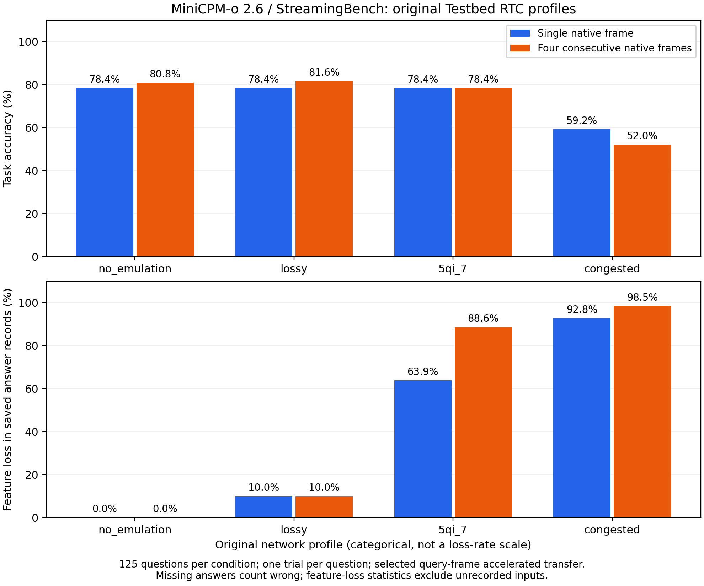

# MiniCPM-o 2.6：原版 Testbed 完整 network profile 测试

固定视频 1–25，每视频 5 题。两种输入 × 四种网络条件，每条件 125 题，共1000个题位。已保存服务器答案956条，缺失44条按错误计分。本轮新增750个题位的真实RTC测试，另复用此前250题无扰动基线并逐文件核验SHA-256。

| 原版 profile | 单帧答对/125 | 单帧准确率 | 四帧答对/125 | 四帧准确率 |
|---|---:|---:|---:|---:|
| no_emulation | 98/125 | 78.4% | 101/125 | 80.8% |
| lossy | 98/125 | 78.4% | 102/125 | 81.6% |
| 5qi_7 | 98/125 | 78.4% | 98/125 | 78.4% |
| congested | 74/125 | 59.2% | 65/125 | 52.0% |

- `lossy` 相对无扰动：单帧+0.0个百分点，四帧+0.8个百分点。
- `5qi_7` 相对无扰动：单帧+0.0个百分点，四帧-2.4个百分点。
- `congested` 相对无扰动：单帧-19.2个百分点，四帧-28.8个百分点。

以上是本次固定125题、每条件一次运行的描述性结果。微小的上升或下降不能证明丢包带来收益，也不能证明存在统计显著差异。拥塞条件中的答案缺失与格式无效同时计入主表，不能将准确率变化全部归因于视觉特征置零。

## 条件与计分

单帧为提问前最近原生帧，四帧为该帧与紧邻前三帧。复用相同已核验的帧缓存，无时间抽样或FPS变换；四帧覆盖的时间窗为3/fps秒。每题独立清空语言模型KV，标准答案仅用于评分。Q4_K_M 语言模型 / F16 视觉编码器及 resampler，llama.cpp b11516 CUDA 12.8，本机 WSL Ubuntu / RTX 3070 8GB。客户端和服务器是两个进程，共享 GPU。

执行公开源码补丁对应的干净 Testbed 副本；保持原版 orchestrator、RTC、UDP/RTP/SRTP、netemu、抓包、SQLite 以及每视频 20 秒间隔。TCP/18124 仅信令，可靠 DataChannel 传问题/特征布局/答案。lo 只做 egress shaping，回环上两个方向各经过一次原队列。

**当前按提问点加速，仅传指定单帧/四帧特征；不是连续原生 FPS 流量或原视频时间轴回放。**

主表按保存的服务器推理答案计分，每条件分母固定125，无效或缺失答案计错。服务器生成答案与客户端成功收齐答案是不同事件，客户端完成率另见下表。使用与此前相同的严格 A–D 响应格式，未删除错误、选择有利重复运行、强制结果单调或隐藏语言先验基线。每视频每条件运行一次，不重跑补齐缺失答案；netem 未另设固定种子，未做多次重复或显著性检验。

## 原版网络配置与实际特征缺失

| profile | 配置摘要 |
|---|---|
| no_emulation | 无 tc/netem 扰动 |
| lossy | 随机丢包 10%，无时延和带宽限制 |
| 5qi_7 | 80ms 延迟、10ms jitter，配置丢包 0.1%，相关 20%，队列 1000 包；原重排保留 |
| congested | 200ms 延迟、50ms jitter，gemodel 3% 设定，相关 40%，1Mbps、队列 200 包；原重排/重复保留 |

以上值是原 YAML 参数，不是实测模型缺失率；完整配置见 `configs/original_profiles.yaml`。随机丢包和队列溢出、重组丢弃、迟到/截止舍弃共同决定模型可用特征。

| 输入 | profile | 特征统计记录数 | 缺失分片/总数 | 不可用特征包 | 特征置零字节比例 | 无效/缺失回答 |
|---|---|---:|---:|---:|---:|---:|
| single | no_emulation | 125/125 | 0/318625 | 0.000% | 0.000% | 0/0 |
| single | lossy | 125/125 | 32004/318625 | 10.044% | 10.044% | 0/0 |
| single | 5qi_7 | 125/125 | 203543/318625 | 63.882% | 63.876% | 0/0 |
| single | congested | 111/125 | 262626/282939 | 92.821% | 92.820% | 3/14 |
| native4 | no_emulation | 125/125 | 0/1274375 | 0.000% | 0.000% | 0/0 |
| native4 | lossy | 125/125 | 127346/1274375 | 9.993% | 9.993% | 0/0 |
| native4 | 5qi_7 | 125/125 | 1128476/1274375 | 88.551% | 88.553% | 1/0 |
| native4 | congested | 95/125 | 953620/968525 | 98.461% | 98.461% | 1/30 |

**特征缺失、置零位置和推理计时仅统计有服务器答案及特征记录的题目。**缺失答案对应的实际模型输入未知，没有推定为全零，也没有放入特征丢包率分母。因此这些特征统计包含记录可用性的选择效应，不能代表所有125题的完整链路丢包率。

### 抓包与队列观测

| 输入 | profile | 抓到的特征消息组/125 | qdisc最大观测drops（分层列示） | RTP最大IP包长 |
|---|---|---:|---|---:|
| single | no_emulation | 125/125 | noqueue=0 | 1167 B |
| single | lossy | 125/125 | netem=35305 | 1167 B |
| single | 5qi_7 | 125/125 | netem=193973 | 1167 B |
| single | congested | 90/125 | htb=212417, netem=212417 | 1167 B |
| native4 | no_emulation | 125/125 | noqueue=0 | 1167 B |
| native4 | lossy | 125/125 | netem=139506 | 1167 B |
| native4 | 5qi_7 | 125/125 | netem=1103523 | 1167 B |
| native4 | congested | 87/125 | htb=871039, netem=871039 | 1167 B |

qdisc值为执行期间的最大观测计数，父子队列不能相加；抓包可见不等于模型收到。队列丢弃计数也不能直接当作模型特征缺失比例。分片缺失以接收端保存的实际输入为准，控制消息和媒体同样经过网卡扰动。抓包过滤排除了3个字节前缀偶合RTP的DNS包（UDP/53）；原始捕获保留，不影响模型输入或答题结果。

每包 F32 特征 1080 字节；单帧 2549 包、四帧 10195 包。保留 Liquid 的 1100 字节 RTP 载荷上限，媒体 IP 包小于 MTU 1500；缺包按原字节位置置零，不从其他问题补特征。RTX 不协商，实际 fork 的 RTX 正/负控制已验证；RTCP/NACK 保留，未添加可靠媒体重传或 FEC。

MiniCPM codec 固定传 F32 特征，未根据 target_bitrate 做额外量化或特征删减；原版传输和反馈路径保留，但此结果只覆盖该固定特征负载适配。

单帧每题2,752,512字节（约2.75MB），四帧11,010,048字节（约11.01MB）；四帧每问的F32特征字节量恰为单帧的4倍。在相同原版带宽和队列预算下，输入增加的视觉信息和增加的传输负担会共同影响准确率。

这个 RTC 实验与此前 1432 字节分片的离线 IID 擦除实验不同：实际网络的突发、有限队列、重排及控制消息也参与链路行为。相同“特征缺失比例”不代表相同缺失位置或同一个损伤分布。总正确率中的残余语言先验不能直接解释为视觉容错；此前 Windows 纯文本/全零对照只作背景，不能冒充这里的 Linux 网络条件。

### 缺失位置分布

将每题原始 F32 特征缓冲按字节位置等分为四段，逐个缺包区间计算交集。表中是各段内部的置零比例，用于观察前缀/尾部缺失差异；这些区间不是图像空间区域。

| 输入 | profile | 0–25% 字节段 | 25–50% | 50–75% | 75–100% |
|---|---|---:|---:|---:|---:|
| single | no_emulation | 0.00% | 0.00% | 0.00% | 0.00% |
| single | lossy | 9.97% | 9.99% | 10.12% | 10.10% |
| single | 5qi_7 | 10.08% | 45.45% | 99.99% | 99.98% |
| single | congested | 73.61% | 99.08% | 99.24% | 99.35% |
| native4 | no_emulation | 0.00% | 0.00% | 0.00% | 0.00% |
| native4 | lossy | 9.99% | 9.95% | 10.06% | 9.98% |
| native4 | 5qi_7 | 65.77% | 99.98% | 99.97% | 88.49% |
| native4 | congested | 94.10% | 99.88% | 99.90% | 99.97% |

## 相对无扰动的逐题变化

| 输入 | profile | 错→对 | 对→错 | 准确率变化（百分点） |
|---|---|---:|---:|---:|
| single | no_emulation | 0 | 0 | +0.0 |
| single | lossy | 0 | 0 | +0.0 |
| single | 5qi_7 | 1 | 1 | +0.0 |
| single | congested | 3 | 27 | -19.2 |
| native4 | no_emulation | 0 | 0 | +0.0 |
| native4 | lossy | 2 | 1 | +0.8 |
| native4 | 5qi_7 | 4 | 7 | -2.4 |
| native4 | congested | 3 | 39 | -28.8 |

## 原版客户端完成率

原版客户端以每视频收齐5条回答判断成功。服务器已保存答案不保证答案已回传到客户端；下表沿用原版视频级完成率，与主表的服务器推理准确率分别报告。受损链路上的控制/完成消息超时及缺失回答均保留，没有延长超时或重跑替换失败视频。

| 输入 | profile | 客户端收齐5条回答的视频数 | 完成率 | 原版视频级response_latency | 客户端答案接收数 | 已保存服务器答案 |
|---|---|---:|---:|---:|---:|---:|
| single | no_emulation | 25/25 | 100.0% | 8.086s | 125/125 | 125/125 |
| single | lossy | 25/25 | 100.0% | 11.047s | 125/125 | 125/125 |
| single | 5qi_7 | 25/25 | 100.0% | 11.026s | 125/125 | 125/125 |
| single | congested | 19/25 | 76.0% | 42.550s | 105/125 | 111/125 |
| native4 | no_emulation | 25/25 | 100.0% | 14.118s | 125/125 | 125/125 |
| native4 | lossy | 25/25 | 100.0% | 19.344s | 125/125 | 125/125 |
| native4 | 5qi_7 | 25/25 | 100.0% | 17.493s | 125/125 | 125/125 |
| native4 | congested | 17/25 | 68.0% | 60.079s | 89/125 | 95/125 |

## 核验与计时边界

1000个固定题位独立重评分，125个问题身份、选项和标准label固定；有记录的跨profile原生帧索引、每帧 SHA-256 与原始特征 SHA-256 均一致。250 组输入（125 题 × 两种方式）重新编码，按各条件记录的缺包索引重建实际模型输入，956条已保存的原始/受损特征字节哈希全部通过；44条无记录的输入没有哈希核验结论。此前完整 250 题无扰动的答案、生成 token IDs 与首步完整 logits 哈希，已与同 Linux 运行时独立未拆分 helper 核对一致。

| 输入 | profile | 平均端侧编码 | 平均语言推理（含排队） | 服务器元数据登记至完整答案 |
|---|---|---:|---:|---:|
| single | no_emulation | 0.451s | 0.436s | 1.854s |
| single | lossy | 0.442s | 0.429s | 2.471s |
| single | 5qi_7 | 0.483s | 0.471s | 2.628s |
| single | congested | 0.586s | 0.591s | 7.251s |
| native4 | no_emulation | 1.448s | 1.135s | 3.563s |
| native4 | lossy | 1.472s | 1.161s | 4.758s |
| native4 | 5qi_7 | 1.495s | 1.178s | 4.371s |
| native4 | congested | 1.652s | 1.418s | 11.465s |

上述计时不是端到端延迟：服务器计时不含端侧编码或答案回传，语言模型调用含共享 GPU 串行等待。答案一次性返回，未测逐 token TTFT。原版视频级 report 的 TTFT/TTLT/stall 字段保留原名，但这里是五个独立问题的整条答案事件，不能当成 token 级时延或卡顿。

[完整汇总 CSV](audit/condition_summary.csv) · [1000 题逐题对照](paired_predictions.csv) · [按视频汇总](per_video.csv) · [相对基线变化](paired_changes.csv) · [客户端完成率](client_completion.csv) · [逐项特征审计](audit/audit.json) · [网络证据](network_evidence.json) · [源码与复现说明](../../docs/testbed_rtc.md)

原始回答在 `dataset/`，原版网络配置、实际 CLI、source patch 身份、基线复用哈希与网络快照一并保留。PCAP/SQLite 的大小和 SHA-256 在网络摘要，原文件留在本机，不上传模型、视频、二进制或含短期 ICE 信令的原抓包。
